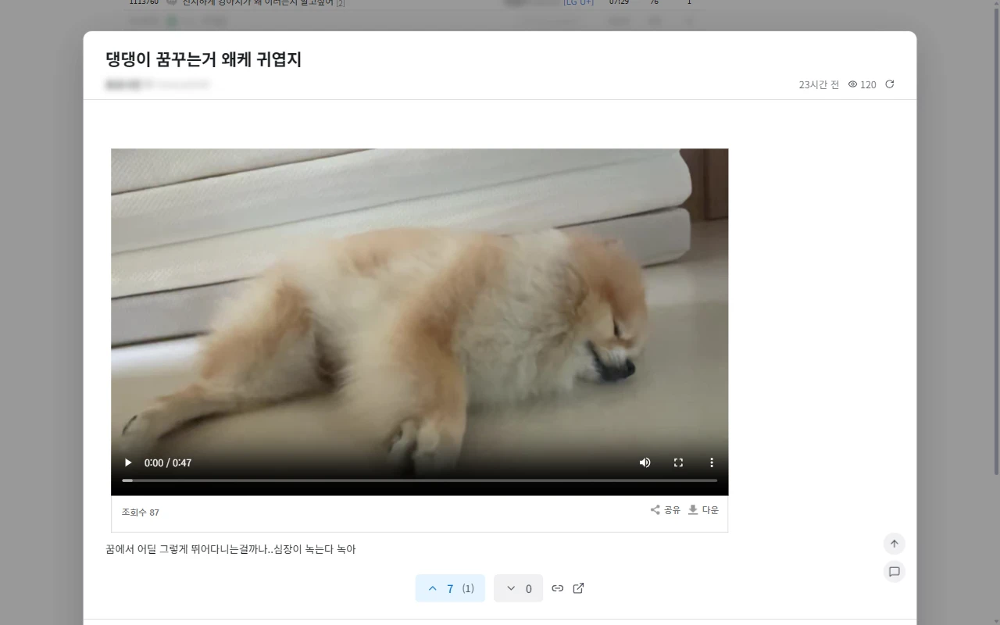
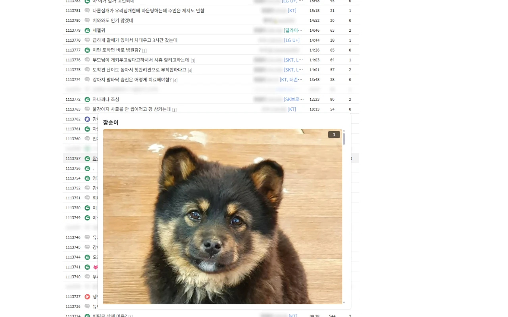

    
    <h1>DCRefresher Reborn</h1>
    
디시인사이드 개선 확장 프로그램

    

        
        
        
    

    

        <a href="https://chromewebstore.google.com/detail/pmfifcbendahnkeojgpfppklgioemgon"><b>Chrome에 설치</b></a>
        ·
        <a href="https://addons.mozilla.org/ko/firefox/addon/dcrefresher-reborn"><b>Firefox에 설치</b></a>
        ·
        <a href="https://github.com/green1052/DCRefresher-Reborn/wiki">위키</a>
        ·
        <a href="https://github.com/green1052/DCRefresher-Reborn/issues">버그 제보</a>
    

    

글을 열지 않고 목록에서 바로 미리 보고, 목록은 알아서 새로고침됩니다. 보기 싫은 유저와 글은 가리고 작성자 옆에 IP 정보(통신사·국가·VPN)와 메모를 붙입니다.

    
    

## 사용법

Chrome 140(Edge·Whale 등 크로뮴 계열 포함), Firefox 144 이상에서 동작합니다. 툴바의 확장 아이콘을 누르면 팝업이 열리고, 여기서 모듈을 켜고 끄거나 톱니바퀴 버튼으로 옵션 페이지를 엽니다.

- 목록에서 제목을 **우클릭**하면 미리보기 창이 열립니다. 원래 우클릭 메뉴는 **Shift+우클릭**으로 엽니다.
- 미리보기 창에서 **PageUp** / **PageDown**으로 앞뒤 글로 넘어가고 **Esc**로 닫습니다.
- 작성자를 우클릭하면 차단·메모 메뉴가 뜹니다.
- 단축키는 목록 새로고침 `Alt+R`, 자동 새로고침 일시정지 `Alt+S`, 스텔스 모드의 이미지 잠시 보이기 `Alt+P`입니다.

자세한 사용법은 [위키](https://github.com/green1052/DCRefresher-Reborn/wiki)에 있습니다.

## 모듈

| 모듈 | 하는 일 |
|---|---|
| [미리보기](https://github.com/green1052/DCRefresher-Reborn/wiki/preview) | 목록에서 글과 댓글을 창으로 봅니다 |
| [글 목록 새로고침](https://github.com/green1052/DCRefresher-Reborn/wiki/refresh) | 목록을 자동으로 새로고침하고 새 글을 표시합니다 |
| [콘텐츠 차단](https://github.com/green1052/DCRefresher-Reborn/wiki/block) | 유저·글·댓글·디시콘·이미지를 숨기거나 흐리게 합니다 |
| [유저 정보](https://github.com/green1052/DCRefresher-Reborn/wiki/userinfo) | 작성자 옆에 아이디·IP 정보·메모·배지를 붙입니다 |
| [레이아웃 수정](https://github.com/green1052/DCRefresher-Reborn/wiki/layout) | 좁은 화면용 컴팩트 모드와 페이지 요소 숨기기 |
| [폰트 교체](https://github.com/green1052/DCRefresher-Reborn/wiki/fonts) | 페이지와 미리보기의 폰트·글자 크기를 바꿉니다 |
| [이미지 검색](https://github.com/green1052/DCRefresher-Reborn/wiki/imagesearch) | 디시 이미지를 우클릭해 검색 엔진에서 찾습니다 |
| [요청 제한](https://github.com/green1052/DCRefresher-Reborn/wiki/requests) | 한꺼번에 보내는 요청 수를 제한해 차단을 막습니다 |
| [스텔스 모드](https://github.com/green1052/DCRefresher-Reborn/wiki/stealth) | 페이지의 이미지와 동영상을 가립니다 (기본 꺼짐) |
| [검색](https://github.com/green1052/DCRefresher-Reborn/wiki/search) | 검색 결과를 이어 붙이고 아이디·IP로 글을 찾습니다 (기본 꺼짐) |
| [글쓰기](https://github.com/green1052/DCRefresher-Reborn/wiki/write) | 쓰던 글을 지키고 올리는 이미지를 WebP로 바꿉니다 (기본 꺼짐) |
| [관리](https://github.com/green1052/DCRefresher-Reborn/wiki/manage) | 갤러리 관리자용 편의 기능 (기본 꺼짐) |

그 밖에 [메모](https://github.com/green1052/DCRefresher-Reborn/wiki/memo), [단축키](https://github.com/green1052/DCRefresher-Reborn/wiki/shortcuts), [데이터 관리](https://github.com/green1052/DCRefresher-Reborn/wiki/data)(클라우드 백업·내보내기·가져오기)가 있습니다.

## 문제 해결

- `요청이 많아 디시인사이드가 잠시 접속을 막았습니다.`가 뜨면 잠시 기다린 뒤 새로고침하세요. [요청 제한](https://github.com/green1052/DCRefresher-Reborn/wiki/requests)의 동시 요청 수를 낮추면 덜 막힙니다.
- `확장 프로그램이 업데이트되었거나 꺼져서 이 페이지에서는 멈췄습니다.`가 뜨면 페이지를 새로고침하세요.
- 그 밖의 문제는 [이슈](https://github.com/green1052/DCRefresher-Reborn/issues/new/choose)로 알려 주세요. 옵션 → **정보** → **진단 정보 복사** 결과를 붙여 주시면 원인을 찾기 쉽습니다.

## 개발·기여

[Bun](https://bun.sh) 1.4 이상과 [Node.js](https://nodejs.org) 25 이상이 필요합니다. `bun install` 뒤 `bun run dev`로 띄웁니다. 자세한 내용은 [개발 문서](docs/README.md)에 있고, 풀 리퀘스트는 `develop` 브랜치로 보내 주세요.

[디스코드 서버](https://discord.gg/SSW6Zuyjz6) · [리프레셔 미니 갤러리](https://gall.dcinside.com/mini/board/lists/?id=bjwg64)
